# Meridian Payments — Settlement Platform Architecture

**Version:** 3.2.0
**Last reviewed:** 2026-08-07
**Audience:** Solution Architects · Platform Engineering · SRE
**Format:** Layered Zone Diagram
**Status:** As-built (reflects deployed `release/3.2` topology)

> **Sample document.** Meridian Payments is a fictional company. Every service
> name, endpoint, table and metric below is invented for demonstration purposes.

> **Delta from the 3.1 baseline reflected in this diagram:**
> - **Dispute Intake** and **Chargeback Orchestrator** are provisioned in the architecture but not yet implemented (stub handlers returning `501`).
> - **FX Quote Service** is partially implemented — infrastructure and circuit breakers are wired; the rate-laddering logic is pending.
> - **Ledger Projection** is a new addition in 3.2: an append-only read model rebuilt from the event log, replacing the direct-query path 3.1 used.
> - `@meridian/ledger-kit` is delivered as a runtime layer (not bundled); consumed by 6 of 9 services.

---

## 1. System Context

Meridian settles card and bank-transfer payments for marketplace operators. A
settlement run collects authorised transactions, nets them per merchant, applies
FX where the payout currency differs from the capture currency, and emits a
payout instruction to a partner bank.

The platform is optimised for one property above all others: **a settlement run
must be replayable and produce a byte-identical result.** Every architectural
choice below — the append-only event log, the absence of a write-through cache,
the idempotency table — follows from that single constraint.

<svg viewBox="0 0 720 150" role="img" aria-label="Settlement lifecycle: capture, net, convert, instruct, reconcile" style="max-width:100%;height:auto">
  <line x1="40" y1="62" x2="680" y2="62" stroke="currentColor" stroke-width="1" opacity="0.25"/>
  <circle cx="60" cy="62" r="9" fill="currentColor"/>
  <text x="60" y="36" text-anchor="middle" font-size="12" fill="currentColor">Capture</text>
  <text x="60" y="92" text-anchor="middle" font-size="10" fill="currentColor" opacity="0.65">T+0</text>
  <circle cx="215" cy="62" r="9" fill="currentColor"/>
  <text x="215" y="36" text-anchor="middle" font-size="12" fill="currentColor">Net</text>
  <text x="215" y="92" text-anchor="middle" font-size="10" fill="currentColor" opacity="0.65">T+1 02:00Z</text>
  <circle cx="370" cy="62" r="9" fill="currentColor"/>
  <text x="370" y="36" text-anchor="middle" font-size="12" fill="currentColor">Convert</text>
  <text x="370" y="92" text-anchor="middle" font-size="10" fill="currentColor" opacity="0.65">T+1 02:14Z</text>
  <circle cx="525" cy="62" r="9" fill="currentColor"/>
  <text x="525" y="36" text-anchor="middle" font-size="12" fill="currentColor">Instruct</text>
  <text x="525" y="92" text-anchor="middle" font-size="10" fill="currentColor" opacity="0.65">T+1 03:00Z</text>
  <circle cx="665" cy="62" r="9" fill="none" stroke="currentColor" stroke-width="2"/>
  <text x="665" y="36" text-anchor="middle" font-size="12" fill="currentColor">Reconcile</text>
  <text x="665" y="92" text-anchor="middle" font-size="10" fill="currentColor" opacity="0.65">T+2</text>
  <text x="360" y="128" text-anchor="middle" font-size="10" fill="currentColor" opacity="0.5">every stage is replayable from the event log — no stage mutates its input</text>
</svg>

---

## 2. Architecture Diagram

```mermaid
graph TD
    %% ─────────────────────────────────────────────
    %% ZONE 1 — EXTERNAL SYSTEMS
    %% ─────────────────────────────────────────────
    subgraph EXT["① External Systems"]
        direction LR
        MKT["🏪 Marketplace Operator<br/>─────────────────<br/>Submits capture batches<br/>& reads payout status<br/>(External Client)"]
        IDP["🔐 Meridian Identity<br/>─────────────────<br/>auth.meridianpay.example<br/>Issues Bearer tokens<br/>(expires_in: 3600s)"]
        BANK["🏦 Partner Bank API<br/>─────────────────<br/>ISO 20022 pain.001<br/>payout instruction sink<br/>(External Service)"]
        FXP["📈 FX Rate Provider<br/>─────────────────<br/>Mid-market rate feed<br/>polled at 60s intervals<br/>(External Service)"]
    end

    %% ─────────────────────────────────────────────
    %% ZONE 2 — EDGE
    %% ─────────────────────────────────────────────
    subgraph GW["② Edge & API Gateway"]
        APIGW["API Gateway<br/>─────────────────<br/>• Bearer token validation<br/>• X-Correlation-ID enforcement<br/>• Per-merchant rate limiting<br/>• Request routing → service<br/>• mTLS termination"]
    end

    %% ─────────────────────────────────────────────
    %% ZONE 3 — SERVICES
    %% ─────────────────────────────────────────────
    subgraph SVC["③ Settlement Services  (Go 1.23 · gRPC internal · Monorepo)"]
        direction LR

        subgraph CORE["Core Settlement"]
            CAP["Capture Intake<br/>POST /v1/captures<br/>batch ingest + validation<br/>✅ Implemented"]
            NET["Netting Engine<br/>POST /v1/runs/net<br/>9-stage pipeline<br/>✅ Implemented"]
            PAY["Payout Instructor<br/>POST /v1/runs/instruct<br/>pain.001 emitter<br/>✅ Implemented"]
            LP["Ledger Projection<br/>GET /v1/ledger/*<br/>append-only read model<br/>✅ Implemented"]
        end

        subgraph MONEY["Money Movement"]
            FXQ["FX Quote Service<br/>POST /v1/fx/quote<br/>🔄 Partial"]
            FEE["Fee Assessor<br/>POST /v1/fees/assess<br/>✅ Implemented"]
        end

        subgraph DISP["Dispute Handling"]
            DI["Dispute Intake<br/>POST /v1/disputes<br/>⚠️ Stub"]
            CB["Chargeback Orchestrator<br/>POST /v1/chargebacks<br/>⚠️ Stub"]
            EVD["Evidence Store<br/>PUT /v1/disputes/evidence<br/>⚠️ Stub"]
        end
    end

    %% ─────────────────────────────────────────────
    %% ZONE 4 — SHARED RUNTIME LAYERS
    %% ─────────────────────────────────────────────
    subgraph LAYERS["④ Shared Runtime Layers  (@meridian/* — provided, not bundled)"]
        direction LR
        LK["@meridian/ledger-kit<br/>─────────────────<br/>Double-entry primitives<br/>Deterministic run IDs<br/>Money type (int64 minor units)<br/>(used by 6 of 9 services)"]
        AK["@meridian/authn<br/>─────────────────<br/>Bearer token validation<br/>+ merchant scope checks<br/>(all 9 services)"]
        SK["@meridian/secrets<br/>─────────────────<br/>Short-lived DB credentials<br/>via workload identity<br/>(all 9 services)"]
    end

    %% ─────────────────────────────────────────────
    %% ZONE 5 — DATA LAYER
    %% ─────────────────────────────────────────────
    subgraph DATA["⑤ Data Layer"]
        direction LR
        PG["PostgreSQL 16<br/>─────────────────<br/>Source of truth · no read cache<br/>Schemas: ledger · merchant · fx<br/>Key tables: CAPTURE, RUN,<br/>RUN_LINE, PAYOUT,<br/>FX_QUOTE, FEE_SCHEDULE,<br/>MERCHANT_ACCOUNT<br/>pgx pool · max 8 conn/instance · TLS"]
        LOG["Event Log (Kafka)<br/>─────────────────<br/>settlement.events<br/>→ append-only, 400d retention<br/><br/>Compacted topic per merchant<br/>→ projection rebuild source"]
        OBJ["Object Store<br/>─────────────────<br/>Signed pain.001 artefacts<br/>Dispute evidence blobs<br/>WORM · 7-year retention"]
    end

    %% ─────────────────────────────────────────────
    %% ZONE 6 — MONITORING
    %% ─────────────────────────────────────────────
    subgraph MON["⑥ Observability"]
        direction LR
        MET["Metrics (Prometheus)<br/>─────────────────<br/>RED per endpoint<br/>Run-lag & netting duration<br/>Alerting rules"]
        TRC["Tracing (OpenTelemetry)<br/>─────────────────<br/>Distributed traces<br/>service → PostgreSQL hops<br/>Correlation ID propagation"]
    end

    %% ─────────────────────────────────────────────
    %% SECRETS (SIDECAR)
    %% ─────────────────────────────────────────────
    KMS["Key Management<br/>─────────────────<br/>Payout signing keys<br/>DB credential issuance<br/>(HSM-backed)"]

    %% ─────────────────────────────────────────────
    %% FLOWS
    %% ─────────────────────────────────────────────

    %% Auth flow
    MKT -->|"1. POST /oauth2/token<br/>client_credentials grant"| IDP
    IDP -->|"Bearer token<br/>(expires 1h)"| MKT

    %% API calls
    MKT -->|"mTLS + Bearer token<br/>+ X-Correlation-ID"| APIGW

    %% Gateway to services
    APIGW -->|"gRPC (sync)"| SVC

    %% Layer injection
    LAYERS -.->|"runtime layers<br/>injected at start"| SVC

    %% External integrations
    FXQ -->|"HTTP · rate poll (60s)"| FXP
    PAY -->|"pain.001 · signed"| BANK

    %% Secrets
    SK -.->|"credential issuance"| KMS
    PAY -.->|"detached signature"| KMS

    %% Data access
    SVC -->|"parameterized SQL<br/>circuit breaker"| PG
    SVC -->|"append events"| LOG
    LOG -->|"rebuild projection"| LP
    PAY -->|"archive artefact"| OBJ

    %% Monitoring
    SVC -->|"metrics"| MET
    SVC -->|"traces"| TRC

    %% Styling
    classDef impl fill:#d4edda,stroke:#28a745,color:#155724
    classDef stub fill:#fff3cd,stroke:#ffc107,color:#856404
    classDef partial fill:#cce5ff,stroke:#004085,color:#004085
    classDef external fill:#e2e3e5,stroke:#6c757d,color:#383d41
    classDef data fill:#f8d7da,stroke:#721c24,color:#721c24
    classDef infra fill:#d1ecf1,stroke:#0c5460,color:#0c5460

    class CAP,NET,PAY,LP,FEE impl
    class DI,CB,EVD stub
    class FXQ partial
    class MKT,IDP,BANK,FXP,KMS external
    class PG,LOG,OBJ data
    class LK,AK,SK,APIGW,MET,TRC infra
```

---

## 3. Legend

| Style | Meaning |
|-------|---------|
| 🟢 Green fill | Fully implemented (production-ready) |
| 🟡 Yellow fill | Stub — present in architecture, handler not implemented |
| 🔵 Blue fill | Partially implemented — infrastructure wired, business logic pending |
| ⬜ Grey fill | External system (outside platform-team ownership) |
| 🔴 Red fill | Data stores |
| 🟦 Teal fill | Platform infrastructure / shared runtime layers |
| `──▶` Solid arrow | Synchronous request or data write |
| `┄┄▶` Dashed arrow | Ambient dependency (injection, credential issuance, signing) |

---

## 4. Zone Responsibilities

| Zone | Owns | Explicitly does **not** own |
|------|------|------------------------------|
| ① External | Client identity, bank rails, rate feeds | Any settlement state |
| ② Edge | AuthN, rate limits, routing, TLS | Business validation |
| ③ Services | All settlement logic and money maths | Durable state (delegated to ⑤) |
| ④ Layers | Cross-cutting primitives, one implementation each | Service-specific logic |
| ⑤ Data | Durability, ordering, retention | Interpretation of the data |
| ⑥ Observability | Signals, alerting, trace correlation | Control-plane actions |

---

## 5. Key Architecture Decisions (As-Built)

| Decision | Pattern | Rationale |
|----------|---------|-----------|
| Compute | 9 services (Go 1.23), gRPC internally, REST at the edge | Predictable latency; no cold-start tax on the 02:00Z run |
| API style | Synchronous REST inbound, async event log internally | Callers get an immediate ack; downstream stays decoupled |
| Auth | Bearer tokens (client credentials) + per-merchant scope | Scope check happens in `@meridian/authn`, never per-service |
| Money representation | `int64` minor units — **never** floating point | Binary floats cannot represent 0.10 exactly; replay must be exact |
| Data access | Direct PostgreSQL, no read-through cache | A cached netting input can silently change a run's result |
| Connection management | pgx pool, max 8 conn/instance, TLS, short-lived credentials | Bounded so a service fleet cannot exhaust the DB |
| Run identity | Deterministic run ID = `hash(merchant, window, input-set)` | Same inputs ⇒ same ID ⇒ replay is idempotent by construction |
| Resilience | Circuit breaker on every outbound call; runs resume from last committed stage | A partner-bank outage delays a run, never corrupts one |
| Idempotency | `RUN` table unique on the deterministic run ID | Duplicate submission is a no-op, not a double payout |
| Ordering | Kafka partition key = merchant ID | Per-merchant total order; cross-merchant order is irrelevant |
| Secrets | Workload identity → HSM-backed issuance; no static credentials | Nothing long-lived on disk or in env |
| Observability | Prometheus (RED) + OpenTelemetry traces, correlation IDs end-to-end | One ID joins gateway log → service span → SQL statement |
| Artefact retention | WORM object store, 7 years | Regulatory; also the replay reference for disputes |

---

## 6. Failure Modes & Degradation

The platform declines heavy or unsafe work rather than grinding through it.
Each row is an enforced threshold, not an aspiration.

| Condition | Threshold | Behaviour |
|-----------|-----------|-----------|
| Capture batch too large | > 50,000 lines | Rejected at intake with `413` + a split-batch hint. Never partially ingested. |
| FX feed stale | Last tick > 300s | Run pauses before Convert; operator is paged. **Never** settles on a stale rate. |
| Partner bank unreachable | 5 consecutive failures | Circuit opens; instructions queue durably; run resumes from last committed stage. |
| Netting exceeds window | > 20 min wall clock | Run continues, `run_lag_seconds` alarm fires at 20 min. No auto-kill mid-run. |
| Projection lag | > 60s behind log | Reads served with an explicit staleness header — never silently stale. |
| Duplicate run submission | Matching deterministic ID | Returns the original run's result, `200` + `Idempotent-Replay: true`. |

---

## 7. What This Diagram Deliberately Omits

Stating the omissions matters as much as the diagram — an architecture diagram
that pretends to be complete is misleading.

- **Deployment topology** (regions, availability zones, replica counts) — see the deployment doc.
- **The netting algorithm's internal stages** — see the request-flow doc.
- **Disaster recovery** and the cross-region failover path.
- **Merchant onboarding**, which runs on a separate control plane.

---

*See also: `meridian-02-request-flow.md` · `meridian-03-data-model.md`*
