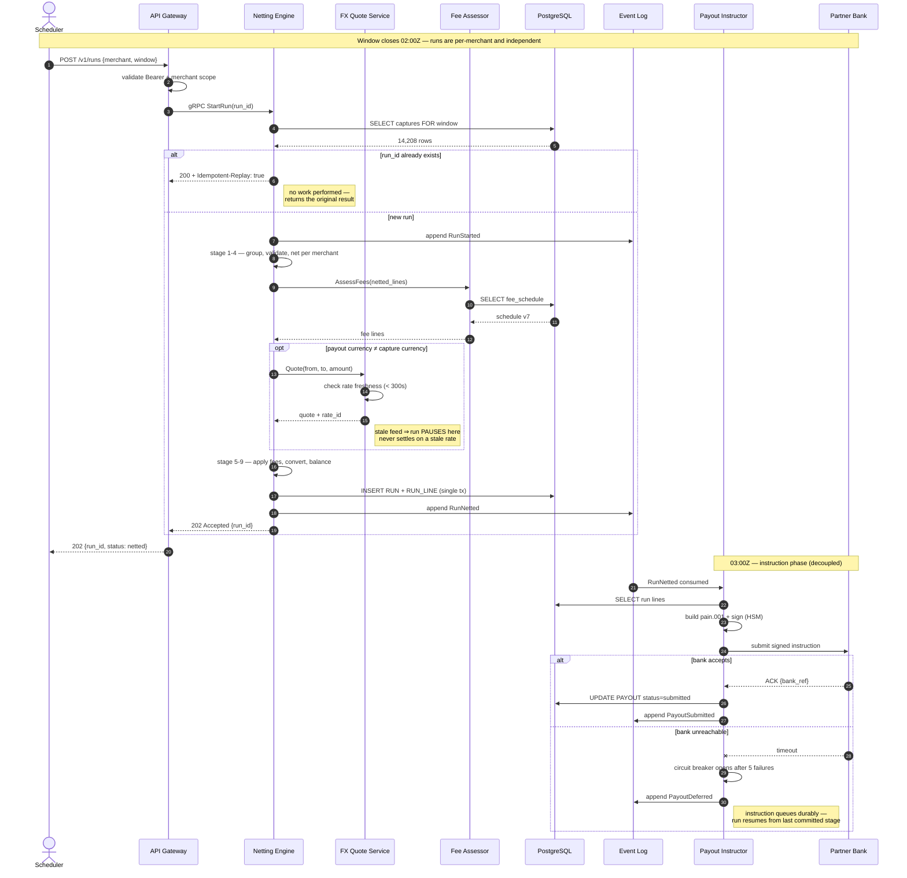
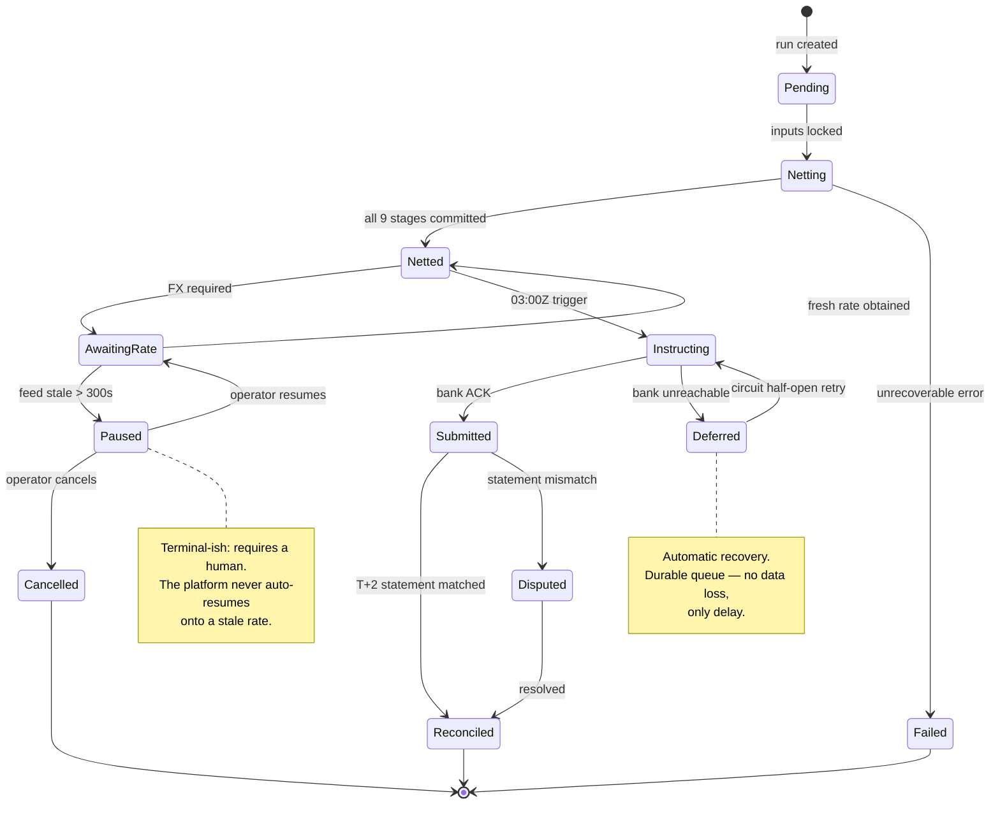

# Meridian Payments — Settlement Run: Request Flow & State Machine

**Version:** 3.2.0
**Last reviewed:** 2026-08-07
**Audience:** Backend Engineers · SRE · On-call
**Format:** Sequence + State Machine
**Scope:** One settlement run, from trigger to reconciled

> **Sample document.** Meridian Payments is a fictional company. Every service
> name, endpoint, timing and error code below is invented for demonstration purposes.

---

## 1. What a Run Is

A **settlement run** is the unit of work that turns a day's authorised captures
into one payout instruction per merchant. Runs are identified by a deterministic
ID derived from their inputs:

```
run_id = blake3(merchant_id ‖ window_start ‖ window_end ‖ sorted(capture_ids))
```

This is the load-bearing design choice in the whole platform. Because the ID is a
function of the inputs, resubmitting the same work **cannot** create a second run
— the uniqueness constraint on `RUN.run_id` rejects it. Idempotency is a property
of the data model rather than a check someone has to remember to write.

---

## 2. Happy Path — Full Run Sequence



---

## 3. Run State Machine

A run only ever moves forward. There is no transition that mutates a completed
stage — recovery re-enters the state machine at the last committed state.



---

## 4. Timing Budget

Measured p95 across 30 days of production runs at the largest merchant tier
(≈ 14k captures per run).

<svg viewBox="0 0 760 210" role="img" aria-label="Stage timing budget as a horizontal bar chart" style="max-width:100%;height:auto">
  <line x1="150" y1="26" x2="150" y2="176" stroke="currentColor" stroke-width="1" opacity="0.3"/>
  <text x="142" y="44" text-anchor="end" font-size="12" fill="currentColor">Load captures</text>
  <rect x="152" y="33" width="72" height="15" fill="currentColor" opacity="0.75"/>
  <text x="234" y="45" font-size="11" fill="currentColor" opacity="0.7">1.8s</text>
  <text x="142" y="72" text-anchor="end" font-size="12" fill="currentColor">Net (stages 1–4)</text>
  <rect x="152" y="61" width="188" height="15" fill="currentColor" opacity="0.75"/>
  <text x="350" y="73" font-size="11" fill="currentColor" opacity="0.7">4.7s</text>
  <text x="142" y="100" text-anchor="end" font-size="12" fill="currentColor">Fee assess</text>
  <rect x="152" y="89" width="44" height="15" fill="currentColor" opacity="0.75"/>
  <text x="206" y="101" font-size="11" fill="currentColor" opacity="0.7">1.1s</text>
  <text x="142" y="128" text-anchor="end" font-size="12" fill="currentColor">FX quote</text>
  <rect x="152" y="117" width="28" height="15" fill="none" stroke="currentColor" stroke-dasharray="3 2"/>
  <text x="190" y="129" font-size="11" fill="currentColor" opacity="0.7">0.7s (conditional)</text>
  <text x="142" y="156" text-anchor="end" font-size="12" fill="currentColor">Convert + commit</text>
  <rect x="152" y="145" width="256" height="15" fill="currentColor" opacity="0.75"/>
  <text x="418" y="157" font-size="11" fill="currentColor" opacity="0.7">6.4s</text>
  <line x1="152" y1="176" x2="700" y2="176" stroke="currentColor" stroke-width="1" opacity="0.3"/>
  <text x="152" y="196" font-size="11" fill="currentColor" opacity="0.6">0s</text>
  <text x="430" y="196" text-anchor="middle" font-size="11" fill="currentColor" opacity="0.6">p95 total ≈ 14.7s · alarm threshold 20 min</text>
</svg>

The commit stage dominates because `RUN` and all `RUN_LINE` rows are written in a
single transaction. That is deliberate: a partially-written run is not a state the
system is willing to represent.

---

## 5. Error Taxonomy

| Code | Condition | Retryable | Caller action |
|------|-----------|-----------|---------------|
| `400 INVALID_WINDOW` | Window end precedes start, or is in the future | No | Fix the request |
| `409 RUN_EXISTS` | Deterministic ID collision with differing inputs | No | Investigate — should be impossible |
| `413 BATCH_TOO_LARGE` | > 50,000 capture lines | No | Split the batch |
| `422 UNBALANCED` | Debits ≠ credits after netting | No | Escalate — indicates a data defect |
| `423 RATE_STALE` | FX feed older than 300s | Yes, after feed recovers | Wait; run is paused, not failed |
| `503 BANK_UNAVAILABLE` | Circuit open on partner bank | Yes, automatic | None — platform retries |
| `504 RUN_TIMEOUT` | Netting exceeded the hard ceiling | Yes | Re-trigger; run resumes from last stage |

**`200` with `Idempotent-Replay: true` is a success, not an error.** It means the
run already existed and the original result was returned unchanged.

---

## 6. On-call Runbook Pointers

| Symptom | First check | Likely cause |
|---------|-------------|--------------|
| `run_lag_seconds` climbing | Netting Engine CPU + `RUN_LINE` insert duration | Merchant tier growth outpacing the pool size |
| Many runs in `Paused` | FX feed last-tick age | Upstream rate provider degraded |
| `Deferred` not clearing | Partner bank circuit state | Bank maintenance window, or expired signing cert |
| Projection staleness header on reads | Event-log consumer lag | Projection consumer crash-looping |
| `422 UNBALANCED` spike | Recent `FEE_SCHEDULE` version change | Fee schedule deployed with a rounding defect |

---

*See also: `meridian-01-architecture.md` · `meridian-03-data-model.md`*
