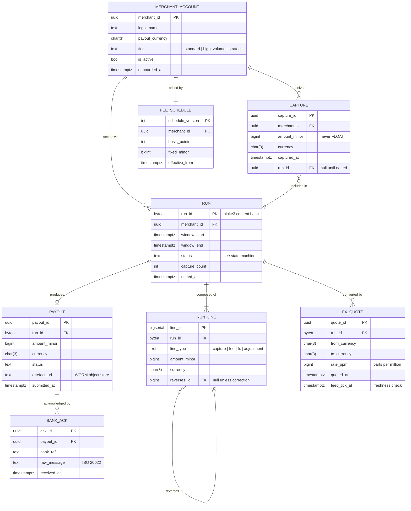
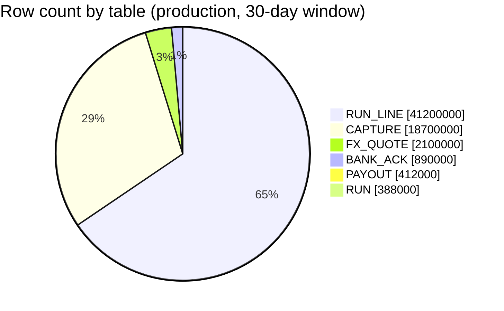
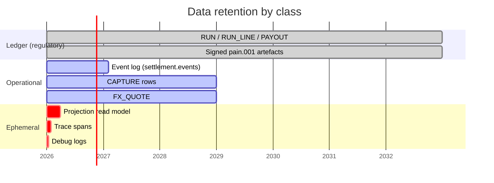

# Meridian Payments — Data Model & Retention

**Version:** 3.2.0
**Last reviewed:** 2026-08-07
**Audience:** Backend Engineers · Data Platform · Compliance
**Format:** Entity Relationship + Retention Schedule
**Schemas covered:** `ledger` · `merchant` · `fx`

> **Sample document.** Meridian Payments is a fictional company. Every table,
> column, volume figure and retention period below is invented for demonstration
> purposes.

---

## 1. Modelling Principles

Four rules govern every table in the `ledger` schema. They are enforced by
constraints and migrations, not by convention.

1. **Money is `BIGINT` minor units plus an ISO-4217 currency code.** Never
   `FLOAT`, never `NUMERIC` without an explicit scale. A binary float cannot
   represent `0.10`, and a settlement platform that cannot represent ten cents
   exactly has no business existing.
2. **Ledger tables are append-only.** Corrections are new rows carrying a
   `reverses_id`, never an `UPDATE`. The history is the product.
3. **Every monetary row belongs to exactly one run.** There is no orphan money.
   `RUN_LINE.run_id` is `NOT NULL` with a foreign key, no exceptions.
4. **Deterministic IDs where replay matters.** `RUN.run_id` is a content hash;
   surrogate keys are reserved for tables where identity is genuinely arbitrary.

---

## 2. Core Entity Relationships

---

## 3. Cardinality Notes

The relationships that are easy to get wrong, stated explicitly:

| Relationship | Cardinality | Why |
|--------------|-------------|-----|
| `RUN` → `RUN_LINE` | one-to-**many, minimum one** | A run with zero lines is meaningless and is rejected at commit |
| `RUN` → `PAYOUT` | one-to-**zero-or-one** | A net-zero run produces no payout, and that is a valid outcome |
| `CAPTURE` → `RUN` | many-to-**exactly one**, eventually | `run_id` is null until netted, then permanently fixed |
| `RUN_LINE` → `RUN_LINE` | self-referential, optional | A correction points at the line it reverses; originals point nowhere |
| `PAYOUT` → `BANK_ACK` | one-to-**many** | Banks may send multiple acknowledgements (accepted, then settled) |
| `MERCHANT_ACCOUNT` → `FEE_SCHEDULE` | one-to-one **at a point in time** | Versioned; the join carries an `effective_from` predicate |

That last row is the subtle one. `FEE_SCHEDULE` is temporal — resolving "the"
schedule for a merchant always requires the run's window, never `now()`. A query
that omits the time predicate will silently price historical runs with today's
fees, which is the single most likely way to produce a `422 UNBALANCED`.

---

## 4. Volume & Growth

`RUN_LINE` dominates by roughly 2:1 over `CAPTURE`, because each capture typically
generates one capture line plus a fee line, and FX-converted runs add a third.
Partitioning follows from that shape.

---

## 5. Partitioning & Index Strategy

| Table | Partitioning | Primary access path |
|-------|--------------|---------------------|
| `RUN_LINE` | Range on `run_id` window month | Always by `run_id` — never scanned globally |
| `CAPTURE` | Range on `captured_at`, monthly | By `(merchant_id, captured_at)` for window selection |
| `RUN` | None — small enough | By `run_id` (PK), or `(merchant_id, window_start)` |
| `PAYOUT` | None | By `run_id`, or `status` for the operator queue |
| `FX_QUOTE` | Range on `quoted_at`, monthly | By `run_id` |
| `BANK_ACK` | None | By `payout_id` |

**No global index on `RUN_LINE.amount_minor`.** Analytical queries over amounts
run against the read model, never the write path — an ad-hoc aggregate on a
41M-row partitioned table would evict the working set the netting run depends on.

---

## 6. Retention Schedule

Retention falls into three tiers, distinguished by one question: **can this be
rebuilt?** Anything reconstructible from the event log is cheap to lose; anything
that is not is regulated.

<svg viewBox="0 0 740 176" role="img" aria-label="Three retention tiers: ledger seven years, operational, ephemeral" style="max-width:100%;height:auto">
  <rect x="14" y="18" width="220" height="128" rx="7" fill="none" stroke="currentColor" stroke-width="1.5"/>
  <text x="124" y="44" text-anchor="middle" font-size="13" fill="currentColor">Ledger + artefacts</text>
  <text x="124" y="70" text-anchor="middle" font-size="22" fill="currentColor">7 years</text>
  <text x="124" y="96" text-anchor="middle" font-size="11" fill="currentColor" opacity="0.7">regulatory · WORM</text>
  <text x="124" y="118" text-anchor="middle" font-size="11" fill="currentColor" opacity="0.7">NOT rebuildable</text>
  <text x="124" y="136" text-anchor="middle" font-size="10" fill="currentColor" opacity="0.5">deletion needs legal sign-off</text>
  <rect x="256" y="18" width="220" height="128" rx="7" fill="none" stroke="currentColor" stroke-width="1" opacity="0.75"/>
  <text x="366" y="44" text-anchor="middle" font-size="13" fill="currentColor">Operational</text>
  <text x="366" y="70" text-anchor="middle" font-size="22" fill="currentColor">400d – 3y</text>
  <text x="366" y="96" text-anchor="middle" font-size="11" fill="currentColor" opacity="0.7">event log · captures · quotes</text>
  <text x="366" y="118" text-anchor="middle" font-size="11" fill="currentColor" opacity="0.7">replay + dispute window</text>
  <text x="366" y="136" text-anchor="middle" font-size="10" fill="currentColor" opacity="0.5">partition drop</text>
  <rect x="498" y="18" width="228" height="128" rx="7" fill="none" stroke="currentColor" stroke-width="1" stroke-dasharray="5 3" opacity="0.6"/>
  <text x="612" y="44" text-anchor="middle" font-size="13" fill="currentColor">Ephemeral</text>
  <text x="612" y="70" text-anchor="middle" font-size="22" fill="currentColor">14 – 90d</text>
  <text x="612" y="96" text-anchor="middle" font-size="11" fill="currentColor" opacity="0.7">projection · traces · logs</text>
  <text x="612" y="118" text-anchor="middle" font-size="11" fill="currentColor" opacity="0.7">fully rebuildable</text>
  <text x="612" y="136" text-anchor="middle" font-size="10" fill="currentColor" opacity="0.5">automatic expiry</text>
  <text x="370" y="166" text-anchor="middle" font-size="10" fill="currentColor" opacity="0.5">precious ◀────────────────────── rebuildability ──────────────────────▶ disposable</text>
</svg>

| Class | Period | Basis | Deletion |
|-------|--------|-------|----------|
| Ledger + artefacts | 7 years | Regulatory | Never automated — legal sign-off required |
| Event log | 400 days | Replay window | Kafka retention policy |
| Captures / quotes | 3 years | Dispute window | Partition drop |
| Projection | 90 days | Rebuildable from log | Truncate + rebuild |
| Traces / debug | 30 / 14 days | Cost | Automatic expiry |

The projection is deliberately the *least* precious store in the system. It can be
dropped and rebuilt from the event log at any time, which is what makes it safe to
change its shape without a migration.

---

## 7. Migration Constraints

Two rules that have no exceptions:

- **No `UPDATE` migrations against `ledger` tables.** A migration that rewrites
  historical monetary rows invalidates every signed artefact derived from them.
  Corrections are appended as reversing lines.
- **Additive columns only, with a default or nullable.** Services deploy
  independently and older instances continue serving during a rollout; a `NOT NULL`
  column without a default breaks every instance that has not yet been replaced.

---

*See also: `meridian-01-architecture.md` · `meridian-02-request-flow.md`*
