# Mermaid Diagram Showcase

How the Halcyon *Aurora* synthesizer is built, sold and shipped, told in twelve kinds
of Mermaid diagram: flowcharts, a sequence, classes, states, entities, a user journey,
a timeline, a Gantt chart, a pie, a git graph, a mind map and a quadrant chart.

## Flowchart (top-down): a voice is allocated

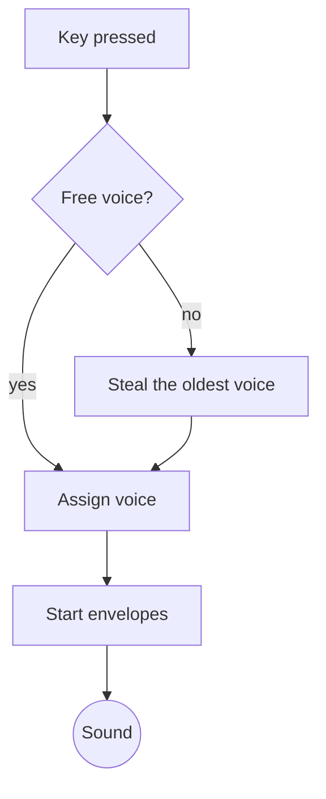

## Flowchart (left-right) with subgraphs: the signal path

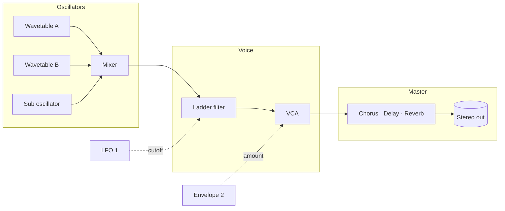

## Sequence diagram: a patch is shared

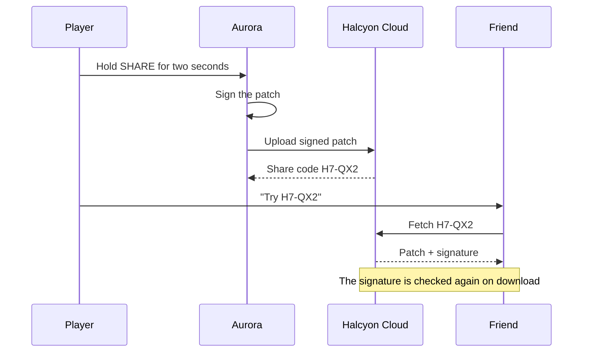

## Class diagram: the patch model

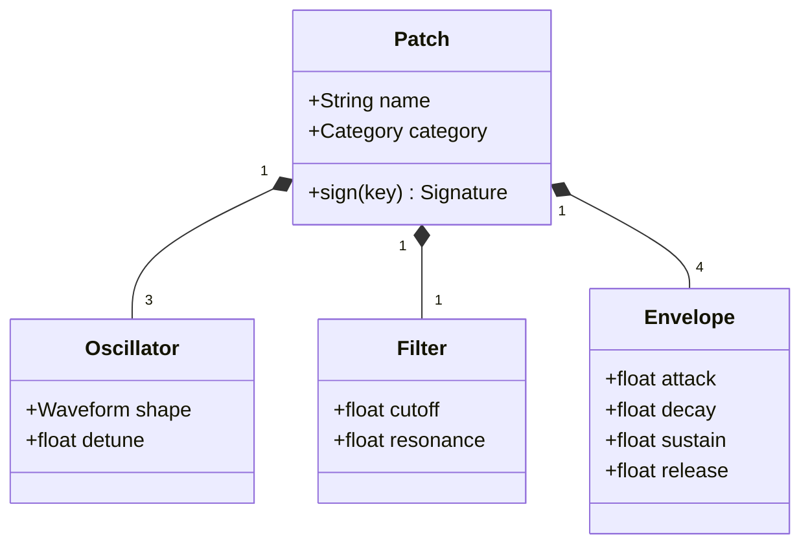

## State diagram: an envelope stage

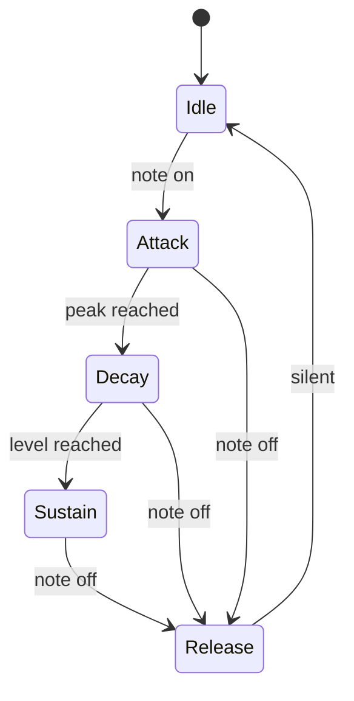

## Entity-relationship diagram: the patch library

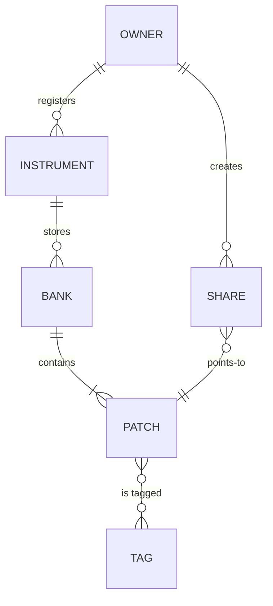

## User journey: first evening with an Aurora

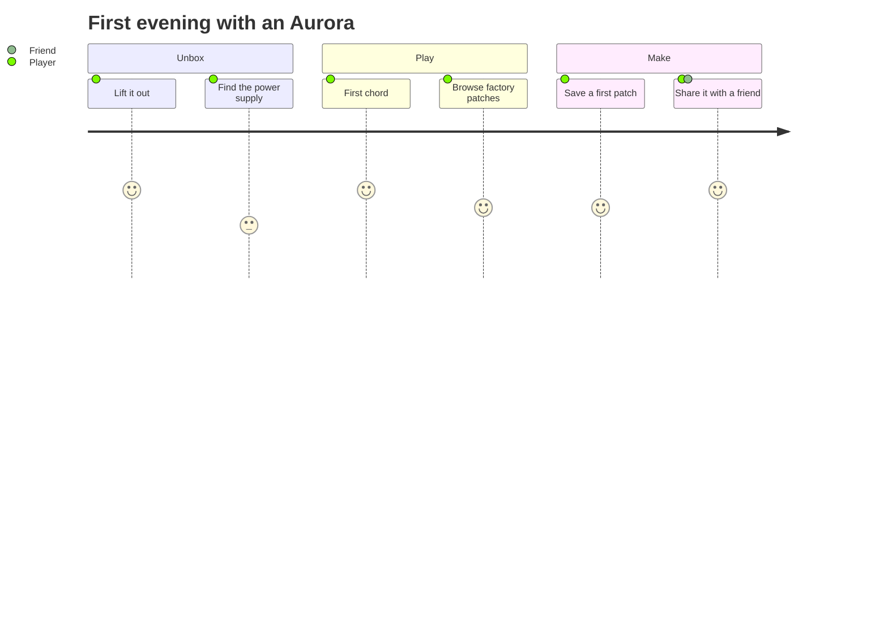

## Timeline: the Aurora family

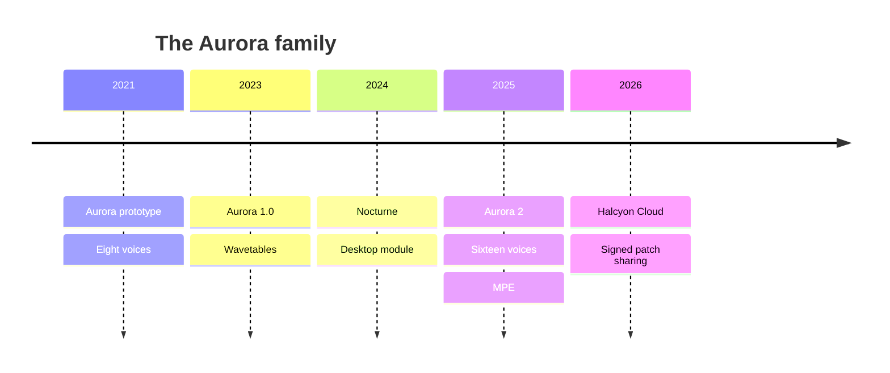

## Gantt chart: Aurora 2.3 firmware

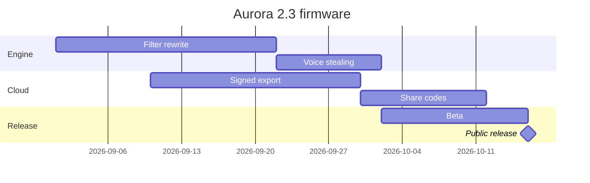

## Pie chart: patches shared, by category

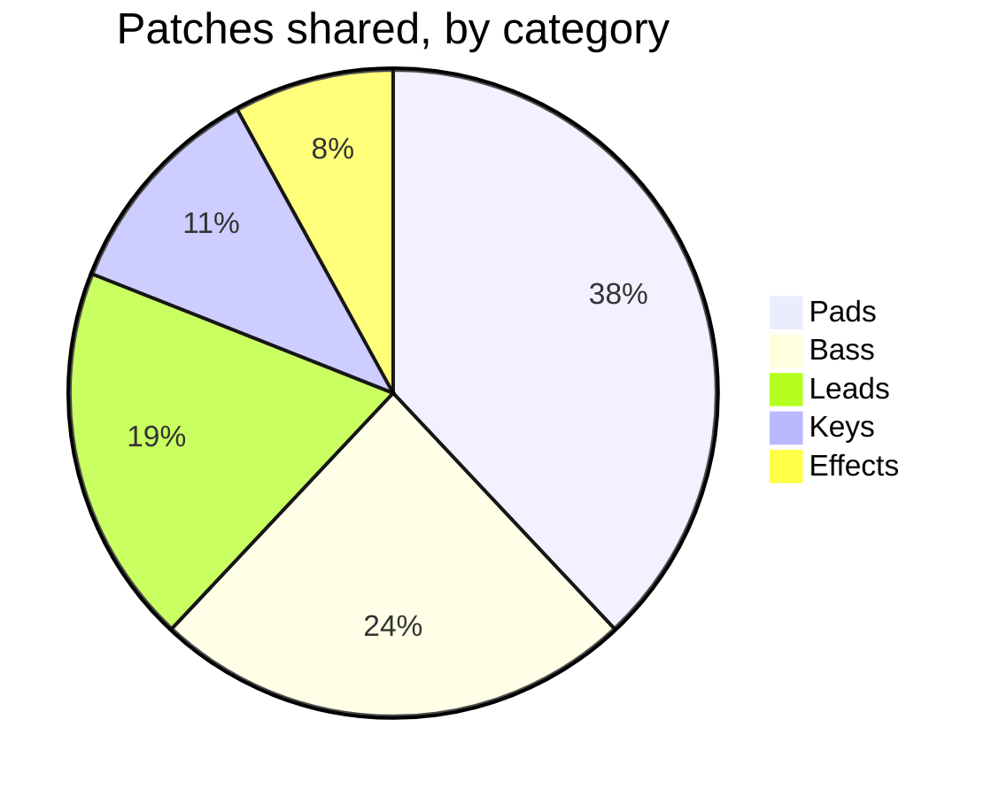

## Git graph: the firmware branches

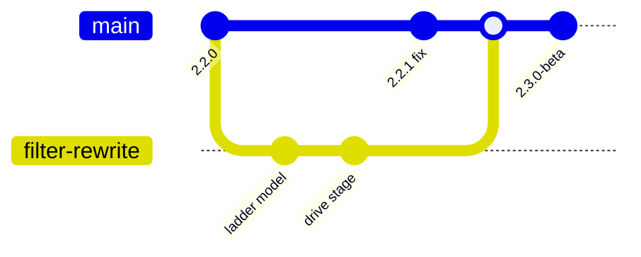

## Mind map: what makes a sound

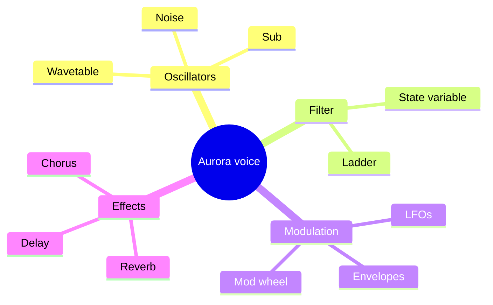

## Quadrant chart: factory patches

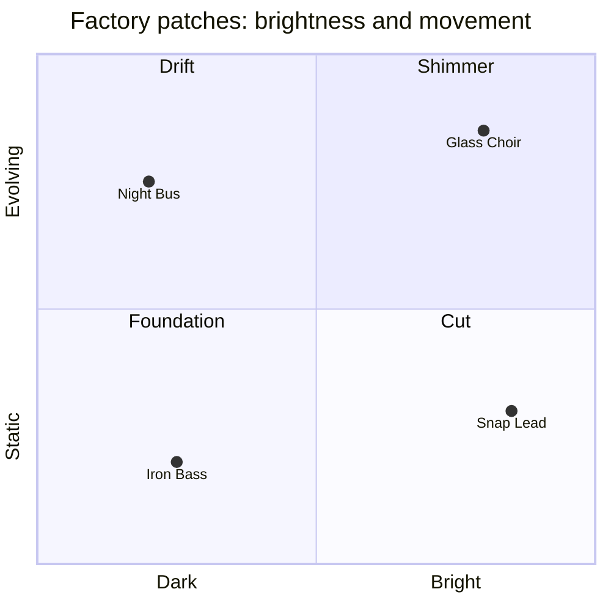
